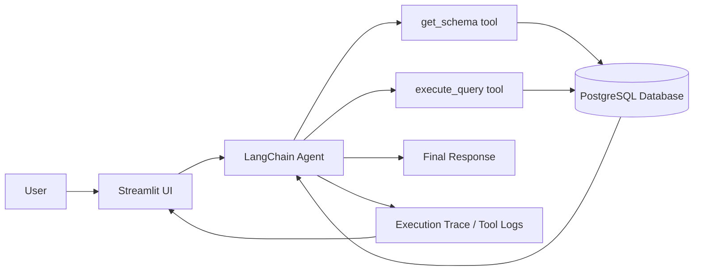

# SQL Agent with Tool Tracing and Streamlit UI

<p align="center">
  
  
  
</p>

<p align="center">
  <strong>Build an AI-powered SQL assistant with LangChain, PostgreSQL, and full execution tracing.</strong>
</p>

## Tagline

Natural language SQL querying with agentic tool calling, PostgreSQL integration, and full traceability for debugging and observability.

## About this project

This project demonstrates how to build a practical AI-powered database assistant using Python, LangChain, PostgreSQL, and Streamlit. It combines natural language processing with tool-calling workflows so an LLM can inspect schema metadata, generate SQL, execute queries, and explain the sequence of actions taken during the request.

It is designed for developers, researchers, and students who want to learn how agentic AI systems interact with real-world tools and databases. The repository includes both command-line experimentation and a browser-based chat interface, making it a useful starting point for building SQL copilots, internal data assistants, and AI observability demos.

The project is particularly relevant for topics such as:

- LangChain agent development
- SQL generation from natural language
- PostgreSQL database integration
- AI tool calling and orchestration
- execution tracing and debugging
- Streamlit UI prototyping

## Why this repository is useful for developers

This repository is useful for developers who want to move from theoretical AI examples to a working, inspectable agent system. It shows how to connect an LLM to a real database, design tool workflows, and verify every decision the agent makes through logs and traces.

It is especially valuable for:

- learning agentic workflows in Python,
- understanding how tool calling works in practice,
- building internal SQL copilots and data assistants,
- learning how to debug LLM behavior with observability,
- prototyping real business workflows without a large framework overhead.

## Architecture overview



This flow makes it easy to understand how user intent, tools, model reasoning, and database execution fit together in one workflow.

## Why this project exists

Modern LLMs are powerful, but they are often disconnected from real systems. This repository shows how to connect a model to a real PostgreSQL database and allow it to:

- inspect the database schema,
- generate SQL from natural language,
- execute SQL safely through tool wrappers,
- explain the resulting workflow through callbacks and traces,
- expose the interaction through a user-friendly UI.

The result is a minimal but realistic example of an agentic SQL assistant.

## Key features

- Natural language querying for PostgreSQL
- Tool-based database access using LangChain tools
- SQL generation and execution workflow
- Full trace capture of LLM calls and tool usage
- Streamlit-based chat interface
- History tracking for conversation flow
- Support for multiple LLM providers through a gateway abstraction
- Open-source-ready, beginner-friendly structure

## SEO and discoverability summary

This repository is intended to be easy to understand and easy to find. It is aligned with search-friendly topics such as:

- LangChain PostgreSQL AI agent
- SQL agent with tool calling
- Streamlit AI database assistant
- LLM SQL generator Python project
- AI observability tool tracing
- PostgreSQL query agent with LangChain
- agentic AI tutorial for database integration

## Project goals

The project is created to help developers understand:

- how agents call functions and tools,
- how model responses can be traced for debugging,
- how database tools can be integrated into LLM workflows,
- how to build a simple but useful SQL assistant,
- how to move from console-only prototypes to a web UI.

## Repository structure

| File | Purpose |
| --- | --- |
| [gateway.py](gateway.py) | Provides a provider-agnostic gateway for OpenAI-compatible APIs like Groq, OpenRouter, NVIDIA, and local Ollama. This minimizes provider-specific code and keeps the app portable. |
| [tool_PostgreSQL.py](tool_PostgreSQL.py) | Defines the PostgreSQL tools, including schema inspection and query execution. It connects to the database and exposes SQL functions to the agent. |
| [agentic_streamlit_ui_app_query_executor.py](agentic_streamlit_ui_app_query_executor.py) | Streamlit UI for chat interaction. It allows users to ask questions, review chat history, and inspect which tools were invoked for each request. |
| [agentic_sys_query_executor_with_tracer.py](agentic_sys_query_executor_with_tracer.py) | Console-based SQL agent that captures complete traces of model messages and tool execution. Useful for debugging and understanding the execution pipeline. |
| [agentic_sys_query_executor_file_handler_with_tracer.py](agentic_sys_query_executor_file_handler_with_tracer.py) | Extended version of the tracing agent with file-handling tools for filesystem operations. It shows how the agent can move beyond database access to broader automation. |
| [agentic_sys_vanilla_query_executor_without_tracer.py](agentic_sys_vanilla_query_executor_without_tracer.py) | Minimal agent without trace capture. Useful as a reference for a simpler setup. |
| [agent_llm_query_executor_with_manual_orchestration.py](agent_llm_query_executor_with_manual_orchestration.py) | Demonstrates manual orchestration of the LLM and tools, showing how the model and tool loop can be controlled manually. |
| [agent_llm_api_query_executor_with_manual_orchestration.py](agent_llm_api_query_executor_with_manual_orchestration.py) | Uses the gateway pattern to orchestrate tool-calling manually with API-based model access. |
| [req.txt](req.txt) | Dependency list required to run the project. |
| [workspace/](workspace/) | Project workspace for examples, generated files, and local test content. |
| [logs/](logs/) | Stores runtime logs and traces generated during execution. |

## Typical workflow

The project follows a standard agentic pattern:

1. The user submits a question in plain English.
2. The LLM decides whether it needs tools.
3. If required, it calls a database tool such as `get_schema` or `execute_query`.
4. The tool returns structured output.
5. The LLM uses that output to craft the final response.
6. A callback layer records the model turn and each tool invocation.
7. The user can inspect the trace in the console or in the UI.

This makes the project a strong learning example for tool-calling and observability.

## Setup instructions

### 1. Create a virtual environment

```bash
python -m venv myenv
```

### 2. Activate the environment

Windows:

```powershell
myenv\Scripts\activate
```

If  an error comes because of UnAuthorized Access then run below command -
```powershell
Set-ExecutionPolicy -ExecutionPolicy RemoteSigned -Scope CurrentUser
```

macOS/Linux:

```bash
source myenv/bin/activate
```

### 3. Install dependencies

```bash
pip install -r req.txt
```

### 4. Configure environment variables
Either 
cp .env.example .env

Or Create a `.env` file in the project root with values similar to:

```env
OPENAI_API_KEY=your_openai_key_here
GROQ_API_KEY=your_groq_key_here
OPENROUTER_API_KEY=your_openrouter_key_here
NVIDIA_API_KEY=your_nvidia_key_here
DB_PASSWORD=your_postgres_password
DB_SCHEMA=aidemo
PROVIDER=groq
```

Important note: the PostgreSQL connection is configured inside [tool_PostgreSQL.py](tool_PostgreSQL.py). Make sure your database exists and the schema name matches your environment.

For GROQ API Key - https://console.groq.com/keys
For OpenAPI Key - https://platform.openai.com/settings/organization/api-keys 

## Run the app

### Streamlit UI

```bash
streamlit run agentic_streamlit_ui_app_query_executor.py
```

### Command-line tracing example

```bash
python agentic_sys_query_executor_with_tracer.py
```

### Minimal version

```bash
python agentic_sys_vanilla_query_executor_without_tracer.py
```

## Example usage

Example user requests include:

- "Show the top 10 orders by amount"
- "What tables exist in the current schema?"
- "List customers from the last 30 days"
- "Find products with inventory below 20"

The model may inspect the schema first and then execute a SQL query to answer the question.

## Tool tracing and observability

One of the strongest parts of this repository is the trace mechanism. The tracing scripts capture:

- messages sent to the model,
- tool invocation requests,
- tool arguments,
- tool outputs,
- any errors that occur,
- final user-facing answer.

This is valuable for:

- debugging model/tool mismatches,
- understanding agent behavior,
- verifying that the right SQL was executed,
- building trust in agent-driven workflows.

## Use cases

This project is useful for:

- learning LangChain agent design,
- building SQL copilots for internal teams,
- prototyping database assistants,
- showing how LLMs can interact with business data,
- demonstrating AI observability and traceability in real applications.

## Open-source value

This project is intentionally simple, educational, and extensible. It can be a good starting point for others who want to build:

- database copilots,
- internal knowledge assistants,
- SQL query automation tools,
- AI workflow prototypes,
- observability dashboards for tool-calling systems.

Because the code is structured around reusable tools and provider-agnostic access, it can be adapted for other data sources beyond PostgreSQL as well.

## Future enhancements

Potential improvements include:

- parameterized SQL validation and safe query guards,
- role-based access controls,
- query cost estimation,
- data visualization in the Streamlit UI,
- support for more database backends,
- persistent trace storage in a database or file archive,
- authentication and session management for the UI.
- Stateful Management for LLM
- Cost Optimization by reducing Token 
- Cloud integration
- DBT Model Setup and integrate with AgenticSQL for Query Generation
- langchain vs langgraph vs langsmith vs langflow vs langfuse
- Vector DB integration 

## Contribution

Contributions are welcome. You can improve the examples, add better safety checks, add visualization, or adapt the project to a more production-ready architecture.


## Summary

This repository demonstrates how to create a practical AI-powered SQL agent that can query a PostgreSQL database using natural language, rely on tool calls, and expose the execution trace in a transparent and understandable way. It merges LLM orchestration, database integration, and UI interaction into a compact, open-source-friendly example.